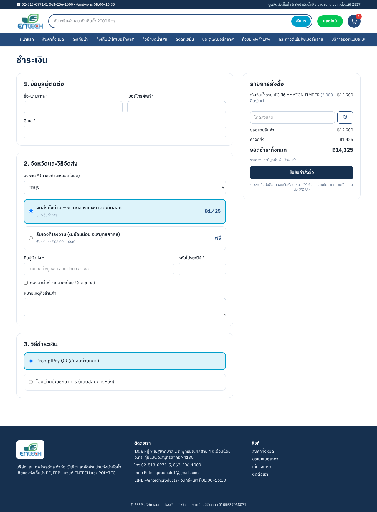
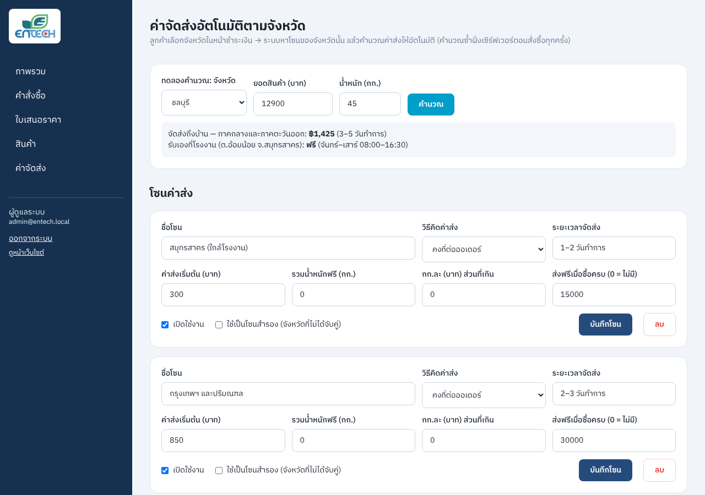

# ENTECH Shop — เว็บไซต์อีคอมเมิร์ซ entech-products.com (เวอร์ชันใหม่)

Next.js 15 (App Router) · React 19 · TypeScript · Tailwind v4 · Drizzle ORM + SQLite/Turso



## เริ่มใช้งาน (เครื่องนักพัฒนา)

ต้องมี Node.js 22.9 ขึ้นไป (LTS)

```bash
npm install
cp .env.example .env        # แล้วแก้ค่าใน .env
npm run db:push             # สร้างตารางในฐานข้อมูล
npm run db:seed             # ใส่สินค้าตาม Price List, โซนค่าส่ง, แอดมิน
npm run dev                 # เปิด http://localhost:3000
```

- หน้าร้านอยู่ที่ `/` และหลังบ้านอยู่ที่ `/admin`
- บัญชีแอดมินเริ่มต้นมาจาก `ADMIN_EMAIL` / `ADMIN_PASSWORD` ใน .env (ค่า default คือ `admin@entech.local` / `Entech@2026`) **ต้องเปลี่ยนก่อนขึ้นจริง**
- `npm run db:reset` ใช้ล้างฐานข้อมูลแล้วใส่ข้อมูลตัวอย่างใหม่
- ถ้ามีฐานข้อมูลอยู่แล้ว `npm run db:push && npm run db:seed` จะเพิ่มเฉพาะสินค้าใหม่ที่ยังไม่มี โดยไม่แตะข้อมูลเดิม
- **อัปเดตเป็นราคา Price List ชุดใหม่ (ก.ค.–ก.ย. 2569):** รายการสินค้าและ SKU เปลี่ยน จึงต้องใช้ `npm run db:push && npm run db:reset` (ล้างข้อมูลเดิมทั้งหมด รวมคำสั่งซื้อทดสอบ)

## ราคาสินค้า (Price List)

- แหล่งข้อมูลเดียวคือ `scripts/data/price-list.csv` (คัดลอกจาก Google Sheet: Tank / Door) และรายการสินค้า + สเปกอยู่ใน `scripts/catalog.ts` (สเปกจาก entechcorporation.com)
- **ราคาขายปลีก** = คอลัมน์ราคาจริง, **ราคาส่ง** = ราคาเมื่อซื้อ 5 ชิ้นขึ้นไป (ระบบลดราคาอัตโนมัติในตะกร้า/ชำระเงิน)
- **ราคาก่อนลด (ขีดฆ่า)** = ราคาขาย +20% ตามคอลัมน์ Mock-up — เปลี่ยนเป็น +40% หรือปิดได้ที่ หลังบ้าน → ค่าจัดส่ง → "ราคาก่อนลด"
- **VAT:** Price List ระบุว่าราคายังไม่รวม VAT → ระบบบวก VAT 7% ในยอดชำระ (ปิดได้ในหลังบ้านถ้าจะตั้งราคาแบบรวม VAT)
- สินค้าที่ไม่มีใน Price List (เช่น AMAZON, ถังไฟเบอร์กลาส, กระถาง) ตั้งราคา 0 = **"สอบถามราคา"** มีปุ่ม LINE OA และขอใบเสนอราคาแทนปุ่มซื้อ
- ทุกหน้าสินค้ามีปุ่ม "ติดต่อฝ่ายขายทาง LINE OA" สำหรับสั่งจำนวนมาก/ต่อรองราคา
- `tests/unit/price-list.test.ts` ตรวจทุกราคาในเว็บเทียบกับข้อความดิบจาก Sheet (`tests/fixtures/price-list-sheet.txt`)

## ค่าจัดส่งอัตโนมัติตามจังหวัด

ตั้งค่าได้ที่ **หลังบ้าน → ค่าจัดส่ง** (`/admin/shipping`)

1. **โซนค่าส่ง** — แต่ละโซนเลือกวิธีคิดได้ 2 แบบ
   - **คงที่ต่อออเดอร์:** ค่าส่ง = ค่าส่งเริ่มต้น
   - **ตามน้ำหนัก:** ค่าส่ง = ค่าส่งเริ่มต้น + (น้ำหนักส่วนที่เกิน “รวมน้ำหนักฟรี” ปัดขึ้นเป็นกิโล × บาทต่อกก.)
   - **ส่งฟรีเมื่อซื้อครบ:** ถ้ายอดสินค้าหลังหักส่วนลดถึงเกณฑ์ ค่าส่งเป็น 0 (ใส่ 0 = ไม่มีส่งฟรี)
2. **จับคู่จังหวัด → โซน** — ทั้ง 77 จังหวัด จังหวัดหนึ่งอยู่ได้แค่โซนเดียว
3. **โซนสำรอง** — จังหวัดที่ไม่ได้จับคู่จะใช้โซนนี้ (ตั้งได้โซนเดียว) ถ้าไม่มีโซนสำรอง จังหวัดนั้นจะสั่งแบบจัดส่งไม่ได้และระบบจะแนะนำให้ขอใบเสนอราคา
4. **รับเองที่โรงงาน** — เปิด/ปิดได้ ค่าส่ง 0 บาท และลูกค้าไม่ต้องกรอกที่อยู่ หน้าคำสั่งซื้อจะแสดงที่อยู่โรงงานพร้อมลิงก์แผนที่
5. **การชำระเงิน** (หน้าเดียวกัน)
   - PromptPay ID และชื่อบัญชีที่จะแสดงใต้ QR
   - บัญชีโอนธนาคาร (ธนาคาร / เลขบัญชี / ชื่อบัญชี) **ถ้าเว้นว่าง ตัวเลือก "โอนผ่านธนาคาร" จะถูกปิดในหน้าชำระเงินอัตโนมัติ**
6. **ทดลองคำนวณ** — ใส่จังหวัด ยอด และน้ำหนัก เพื่อดูค่าส่งก่อนบันทึก

เมื่อลูกค้าเลือกจังหวัดในหน้าชำระเงิน ระบบจะแสดงค่าส่งและยอดรวมทันที แล้ว**คำนวณซ้ำฝั่งเซิร์ฟเวอร์ตอนสั่งซื้อทุกครั้ง** ราคาหรือค่าส่งที่ส่งมาจากเบราว์เซอร์จึงไม่มีผล

ค่าเริ่มต้นใน seed (จากชีต Delivery Fee ต้องยืนยันกับลูกค้า):

| โซน | ค่าส่ง |
|---|---|
| กรุงเทพฯ ปริมณฑล และสมุทรสาคร (รถกระบะ) | 2,500 บาท/ออเดอร์ |
| ต่างจังหวัด (โซนสำรอง, ขนส่งเอกชน) | 5,000 บาท/ออเดอร์ |

ออเดอร์ใหญ่ที่ต้องใช้รถ 6 ล้อ/สิบล้อ/เครน ให้เสนอราคาแยก (มีตารางอ้างอิงในหน้าค่าจัดส่ง)



## หน้าข้อมูล

- `/about` ประวัติ ข้อมูลบริษัท มาตรฐาน มอก. และตัวอย่างผลงาน (จาก entechcorporation.com)
- `/faq` คำถามที่พบบ่อย 12 ข้อ (ค่าส่ง VAT และช่องทางชำระเงินดึงจากการตั้งค่าในหลังบ้านอัตโนมัติ) พร้อม FAQ schema สำหรับ Google
- `/terms` เงื่อนไขการสั่งซื้อ และ `/privacy` นโยบายความเป็นส่วนตัว (PDPA) **ฉบับร่าง ต้องให้บริษัทตรวจก่อนเปิดจริง**
- `/articles` บทความตั้งต้น 6 เรื่อง (คู่มือเลือกขนาดถัง 2 เรื่อง + ข่าวกิจกรรมจากเว็บเดิม 4 เรื่อง) แก้ไขได้ในหลังบ้าน

## หลังบ้านทำอะไรได้บ้าง

- **ภาพรวม:** ยอดขาย ออเดอร์ล่าสุด และสินค้าใกล้หมด
- **คำสั่งซื้อ:** กรองตามสถานะและเปลี่ยนสถานะ
  - เปลี่ยนเป็น “ยกเลิก” → คืนสต็อกอัตโนมัติ
  - เปิดออเดอร์กลับมาใหม่ → ตัดสต็อกอีกครั้ง
  - กดซ้ำจะไม่คืนสต็อกซ้ำ
- **จัดการหน้าแรก (`/admin/home`):** แก้แบนเนอร์หลัก (รูป ข้อความ ปุ่ม ตำแหน่งรูปซ้าย/ขวา) · เลื่อนลำดับส่วนต่าง ๆ ด้วย ▲▼ และซ่อน/แสดงได้ · แก้กล่องจุดเด่น แถบปิดท้าย และข้อความ Google · มีตัวอย่างหน้าเว็บ (คอม/มือถือ) ข้างฟอร์ม และเตือนเมื่อยังไม่บันทึก
- **ข้อมูลร้าน & ติดต่อ (`/admin/site`):** เบอร์โทร LINE อีเมล ที่อยู่ แผนที่ เวลาทำการ ข้อความแถบบนสุด — แก้ที่เดียวเปลี่ยนทุกหน้า
- **อัปโหลดรูป:** เลือกหรือลากไฟล์มาวาง ระบบย่อขนาดในเบราว์เซอร์แล้วเก็บในฐานข้อมูล (`/media/<id>`) ใช้ได้ทั้งในเครื่องและบน Vercel โดยไม่ต้องตั้งค่าที่เก็บไฟล์เพิ่ม
- **สินค้า:** เปลี่ยนรูปสินค้า แก้ชื่อ คำอธิบาย ป้าย สินค้าแนะนำ เปิด/ปิดการขาย และ SEO title/description ต่อสินค้า
  - แต่ละตัวเลือกแก้ราคา ราคาส่ง (ขั้นต่ำกี่ชิ้น) ราคาก่อนลด สต็อก และน้ำหนักได้ · ราคา 0 = สอบถามราคา · มีช่องตารางสเปก
- **บทความ:** เขียน แก้ไข และเผยแพร่บทความได้ที่ `/admin/articles` (ปิดไว้ = ฉบับร่าง ลูกค้าไม่เห็น) ผู้เข้าชมดูได้ที่ `/articles` เนื้อหาเป็นข้อความล้วน เว้นบรรทัดว่างหนึ่งบรรทัดเพื่อขึ้นย่อหน้าใหม่
- **ใบเสนอราคา:** คำขอจากหน้าติดต่อเรา และติดตามสถานะได้
- **ค่าจัดส่ง:** ตามหัวข้อด้านบน รวมถึง PromptPay ID สำหรับสร้าง QR

## SEO

- แต่ละหน้ามี title, description และ canonical
- หน้าสินค้ามี JSON-LD แบบ Product และหน้าแรกมีแบบ Organization
- มี `sitemap.xml` และ `robots.txt` (ซ่อน admin, cart, checkout และ order จาก Google)
- **URL เดิมของ ReadyPlanet redirect 301 ไปหน้าใหม่** (ดู `next.config.ts`) จึงไม่เสียอันดับ Google

## ความปลอดภัย

- ราคา ค่าส่ง ส่วนลด และสต็อกคำนวณจากฐานข้อมูลฝั่งเซิร์ฟเวอร์เท่านั้น
- ตัดสต็อกใน transaction และกันขายเกินสต็อกเมื่อหลายคนสั่งพร้อมกัน (มีเทส)
- หน้าคำสั่งซื้อเปิดได้เฉพาะลิงก์ที่มี key สุ่ม จึงเดาเลขออเดอร์ของคนอื่นไม่ได้
- ระบบล็อกอินแอดมิน
  - เก็บรหัสผ่านแบบ bcrypt และ session เป็น cookie แบบ httpOnly ที่ลงลายเซ็น HMAC
  - ล็อกอินผิดเกิน 8 ครั้งต้องรอ 15 นาที
- ฟอร์มขอใบเสนอราคามี honeypot กันบอท

## ทดสอบ

```bash
npm run lint && npm run typecheck
npm test                    # unit test ค่าส่ง/คูปอง/จังหวัด/ราคาตาม Price List (69 เทส)
npx playwright install chromium   # ครั้งแรกครั้งเดียว
npm run test:e2e            # E2E 42 เทส: API, หน้าร้าน, UX/การเข้าถึง, มือถือ, หลังบ้าน (ใช้ฐานข้อมูลแยก data/test.db)
```

## ขึ้นระบบจริง (แนะนำ Vercel + Turso)

1. สร้างฐานข้อมูลบน [Turso](https://turso.tech) (SQLite บนคลาวด์ ฟรีในระดับเริ่มต้น) แล้วนำ URL และ token มาใส่
2. ตั้ง Environment Variables บน Vercel
   - `DATABASE_URL=libsql://...` และ `DATABASE_AUTH_TOKEN=...`
   - `SITE_URL=https://www.entech-products.com` **บังคับตั้ง ถ้าไม่ตั้ง ระบบจะไม่ยอมรันบน production** (กัน canonical และ sitemap ชี้ไป localhost)
   - `SESSION_SECRET=` สุ่มยาว 32 ตัวขึ้นไป (`openssl rand -hex 32`) **ถ้าไม่ตั้ง หลังบ้านจะล็อกอินไม่ได้ ซึ่งเป็นการตั้งใจเพื่อความปลอดภัย**
   - `ADMIN_EMAIL` และ `ADMIN_PASSWORD`
3. รัน `npm run db:push && npm run db:seed` โดยชี้ไปที่ Turso หนึ่งครั้ง
4. ชี้โดเมนมาที่ Vercel แล้วส่ง sitemap ใน Google Search Console

ถ้าจะใช้ VPS แทน ให้ใช้ `npm run build && npm start` ได้เลย โดยใช้ SQLite ไฟล์ `data/entech.db` และสำรองไฟล์นี้เป็นประจำ

## สิ่งที่ต้องยืนยันกับลูกค้าก่อนเปิดจริง

- สต็อก (ตั้งไว้ 100 ทุกรายการ) และน้ำหนักสินค้า — ราคามาจาก Price List แล้ว
- การแสดงราคาก่อนลด +20% ต้องเป็นราคาที่เคยขายจริง (ข้อกำหนด สคบ. เรื่องโฆษณาลดราคา)
- อัตราค่าส่งแต่ละโซน และการจับคู่จังหวัด
- PromptPay ID (ตอนนี้ตั้งเป็น 0632061000) และเลขบัญชีธนาคารสำหรับการโอน
- คูปองตัวอย่าง `ENTECH500` (ลด 500 เมื่อซื้อครบ 5,000)
- ยังไม่มีอีเมลยืนยันคำสั่งซื้อ (ต้องเลือกบริการส่งเมล เช่น Resend/SendGrid) ระหว่างนี้ลูกค้าดูคำสั่งซื้อย้อนหลังได้ที่ `/order/lookup` ด้วยเลขคำสั่งซื้อ + เบอร์โทร

## รูปประตู (ตัดพื้นหลัง)

รูปประตูทุกรุ่นตัดพื้นหลังแล้ววางบนพื้นขาวขนาดเท่ากัน (800×1200, ประตูสูง 86%) ต้นฉบับอยู่ที่ `assets/door-originals/`
ถ้าเพิ่มรูปรุ่นใหม่ ให้วางไฟล์ `door-edxx-yy.jpg` ใน `public/images/products/` แล้วรัน
`pip install "rembg[cpu]" && python3 scripts/cutout-doors.py` (รันซ้ำได้ อ่านจากต้นฉบับเสมอ)

## แนวทางดีไซน์

ดู [DESIGN.md](DESIGN.md) ซึ่งอธิบาย token สี ตัวอักษร ปุ่ม ฟอร์ม และสถานะ ทุกคู่สีผ่าน WCAG AA และมีเทสตรวจอัตโนมัติ

## โครงสร้างโค้ด

```
src/app/(shop)/      หน้าร้าน: หน้าแรก สินค้า ตะกร้า ชำระเงิน คำสั่งซื้อ บริการ ติดต่อ
src/app/admin/       หลังบ้าน (มี middleware ป้องกัน)
src/app/api/         checkout/preview, orders, quotes
src/lib/shipping.ts  สูตรค่าส่ง (pure function มี unit test)
src/lib/checkout.ts  คำนวณราคา/สร้างคำสั่งซื้อฝั่งเซิร์ฟเวอร์
src/db/schema.ts     โครงสร้างฐานข้อมูล
scripts/seed.ts      ข้อมูลตั้งต้น (สินค้าจริงจากเว็บเดิม)
tests/               unit + E2E
```
